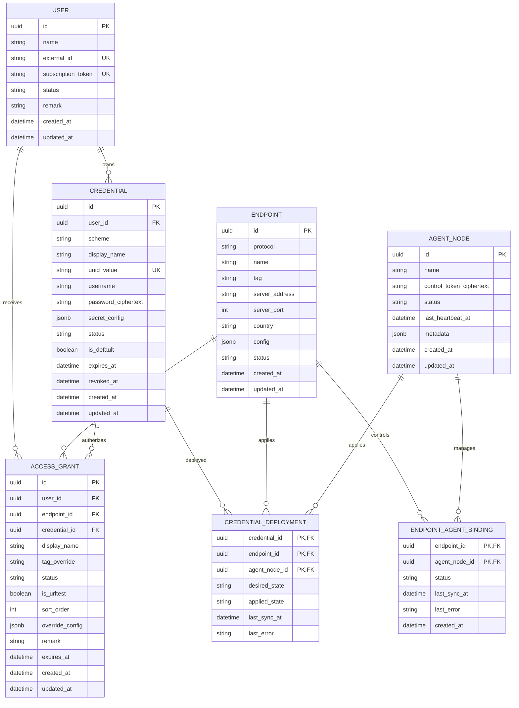

# 领域模型 ER 图

目标数据库：PostgreSQL。



## 1. 关系定义

```text
User 1 ── N Credential
User 1 ── N AccessGrant
Credential 1 ── N AccessGrant
Endpoint 1 ── N AccessGrant
Endpoint N ── N AgentNode
```

同一 User 的多个 AccessGrant 可以复用同一个 Credential。Credential 不允许被不同 User 共享。

Credential 可以没有 AccessGrant，此时状态为 `pending_binding`。AccessGrant 必须同时具有 User、Endpoint 和 Credential。

## 2. Endpoint

```text
Endpoint = 实际地址 + 端口 + 协议 + 协议参数
```

Endpoint 不是协议模板，不保存 UUID、Username、Password 等用户级凭证。

`config` 使用 JSONB 保存协议专属参数，但写入必须通过协议契约的强类型解析和严格校验。

## 3. Credential

Credential 属于 User，不属于 Endpoint。凭证可轮换、过期、禁用或撤销。

密码等敏感字段加密存储。服务端需要生成客户端配置或同步 Agent，因此不能只保存单向哈希。

`uuid_value` 只用于 UUID 型认证方案；Socks5 等方案使用 Username 和 Password。

## 4. AccessGrant

AccessGrant 是用户获得 Endpoint 访问权的授权关系，保存：

- 用户是否被分配该 Endpoint；
- 用户侧展示名称和 Tag 覆盖；
- 订阅排序和 URL Test；
- 用户对该 Endpoint 的有限覆盖配置；
- 授权有效期和状态。

AccessGrant 不复制 Credential 内容。

## 5. Node

Node 是动态领域对象，不建立独立持久化表：

```text
Node = Endpoint + Credential + AccessGrant
```

导出流程：

```text
验证 User
    ↓
查询有效 AccessGrant
    ↓
检查 Endpoint 和 Credential
    ↓
组装 Node
    ↓
交给 Sing-box / Xray / Mihomo 导出器
```

## 6. Agent

AgentNode 表示真实 VPS、母鸡或部署 Agent 的物理运行节点。

Endpoint 通过 EndpointAgentBinding 与 AgentNode 建立部署控制关系。当前手动部署时没有绑定记录。

Credential 不直接保存 `agent_id`。CredentialDeployment 只记录凭证期望状态和实际同步状态，不改变控制面的授权关系。

## 7. 撤销

```text
Credential 到期或撤销
    ↓
订阅停止导出相关 Node
    ↓
有 Agent：生成 CredentialDeployment 撤销状态
无 Agent：生成管理员手动操作告警
    ↓
服务端停止接受该 Credential 后，已下载 JSON 才真正失效
```

## 8. 当前模型迁移

| 当前模型 | 目标模型 |
|---|---|
| `Node` | `Endpoint` |
| `Endpoint.UUID/Password/Username` | `Credential` |
| `Endpoint.UserID + NodeID` | `AccessGrant` |
| `Endpoint.Tag/SortOrder/IsURLTest/Remark` | `AccessGrant` |
| `User.UUID/Password` | 没有旧 Endpoint 凭证时生成默认 Credential |
| `UserNodeLink` | 删除，由 `AccessGrant` 取代 |
| 动态完整节点 | `Node`，不入库 |
