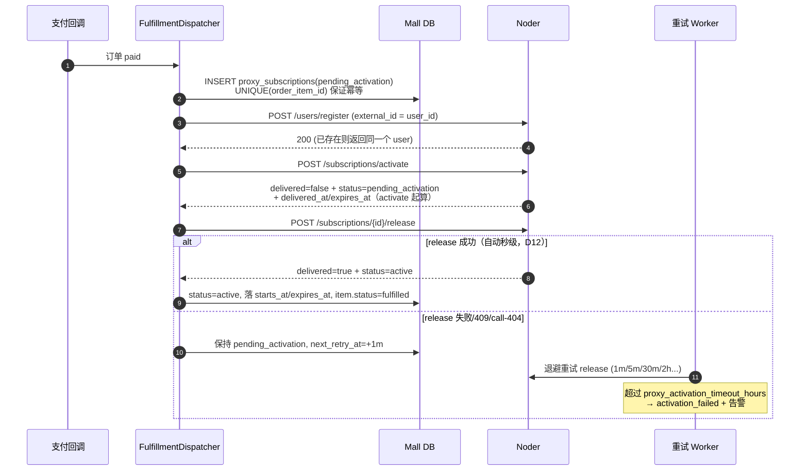

# 对接 Noder：代理订阅交付设计定稿

> 状态：定稿 v3.5
> 日期：2026-11-09
> 涉及仓库：`Mall`（`/home/ryu/code/Mall`）、`Noder`（`/home/ryu/code/noder`）
> 相关文档：[代理网络模型解耦](../decisions/proxy_architecture_split.md)、[代理节点自动交付与路由](../architecture/proxy_delivery_automation.md)、[Agent 控制面设计](./attach-agent.md)、[流量计费与配额](./traffic-billing.md)、[Xray 流量统计实验记录](./xray-stats-experiment.md)、[线上迁移手册 D10](./prod-d10-sqlite-runbook.md)、[Mall 履约实施规范](./mall-proxy-fulfillment-spec.md)

**修订记录**

- v1：Mall ↔ Noder 交付契约、订阅表、到期/退款口径。
- v2：按“一台线路机服务多个出口”修正端点映射（新增 `exit_route_tag`）；补充数据面选型结论（不以 3x-ui 为集成点）；落地机健康探测明确由线路机 Agent 承担。
- v3：流量计费从“非目标”提升为 P1。新增 `traffic_quota_bytes` 契约、`proxy_usage_daily`、`POST /subscriptions/{id}/quota`；并定稿 `socks` 不做流量计量、按无限流量售卖。计量细节见 [流量计费与配额](./traffic-billing.md)。
- v3.1：T0 计量可行性实测通过（见 [实验记录](./xray-stats-experiment.md)）；修正 socks 计量认知（技术上可行），D9 措辞更新为“主动选择而非技术妥协”。
- v3.2：**权益粒度对齐订单项**（新增决策 D10）：同一用户可在同一线路机持有多个出口、同一出口可购买多份——Noder 唯一索引 `access_grant_user_endpoint_idx` 废弃，改按订单幂等（`external_ref (order_item_id)` 唯一）；续费（`extend`）与再购买（下单 = 独立订阅）定稿；`activate` 增加可选 `tag_override`（方案 A：Noder 自动生成 `#N`）；P0 新增索引迁移。
- v3.2 + D11：同一用户禁止同时持有两个“指向同一落地 IP”的有效订阅——`landing_group` 归组、下单前置拦截 + 履约兜底；socks/landing 同组拦截，退款即释放；后台 `landing_group` 新节点**强制必填**，存量节点上线 checklist 补齐归组（否则规则不生效）。
- v3.4（2026-11-05）：D10 迁移按**生产 SQLite + systemd** 落地（`scripts/migrate_d10.sh` + [线上迁移手册](./prod-d10-sqlite-runbook.md)）；`credential_id` **不做全局唯一**（legacy 投影里多个 grant 共享同一 credential 为合法状态）；唯一约束只落在 `external_ref`；`migrations/001_refactor_domain.sql` 明确标注为目标 PG 参考 DDL、**生产未使用**。
- v3.3（2026-11-05）：**D11 全部定稿**（两个占位 = 占位）；`tag_override` 续号规则定稿（历史 grant 数+1，永不重用）；UDP 计量实测通过（[实验记录](./xray-stats-experiment.md) §3.H）。（本版的“R1–R4（PG 语法）迁移方案”已被 v3.4 整体取代。）
- v3.5（2026-11-09）：**activate 不再自动可用，必须手动 release**（Noder `main@39eef44`）。新增 `POST /api/service/subscriptions/{id}/release`；`activate` 只建 `pending_activation`，`release` 后才 `active`；`expires_at` 起算点定为 **activate 时**（`release` 不重算）；`release` 触发方定为 Mall dispatcher 自动调 + admin 补调；探测不阻塞放行；`expired` 可 `extend` 续费救回。§4/§7/§8/§13 同步重写。

本文是当前落地口径。旧的 `architecture/proxy_delivery_automation.md` 描述了基于 3x-ui + `/api/v1/deliveries` 的方案，与 Noder 现有实现不一致；两者冲突时以本文为准，旧文档保留为历史方案。

---

## 1. 结论摘要

**不需要新造一套对接协议。** Noder 已经具备 `/api/service/*` 服务接口、`X-Service-Token` 鉴权、`User.external_id` 唯一索引、`access_grants.expires_at` 到期过滤。

真正要做的是四件事：

1. **修 Noder 的 4 个缺陷**（其中一个是收入漏洞，一个是权益粒度错配）。
2. **补 Noder 的 6 个服务接口**（activate / release / get / extend / revoke / quota；其中 release 为 v3.5 新增）。
3. **补 Mall 的履约链路**（订阅表、provider 映射、两步开通 dispatcher、重试与对账 worker）。
4. **补流量计量与配额执行**（Xray Stats + Agent 上报，见 [流量计费与配额](./traffic-billing.md)）。

工作量集中在 Mall 侧，Noder 侧是小改动 + 少量新接口。

> **v3.5 核心变更（先看这段）**：`activate` 现在只创建 **pending_activation**（客户端不可用，`/sub` 不渲染、socks auth-list 不下发），Mall 必须在希望下发给客户可用的时机调 `release`，成功后才变为 `active`。`expires_at/delivered_at` 在 `activate` 时由 Noder 按 `now + duration_seconds` 计算并固定，`release` 不重新起算。Mall 侧触发方定为 dispatcher 自动调 + admin 补调（见 §4 决策 D12）。

---

## 2. 系统边界

| 关注点 | 归属 | 说明 |
| --- | --- | --- |
| 卖什么、多少钱、卖给谁、有效多久 | **Mall** | 交易核心，唯一售卖入口 |
| 怎么连、用什么协议、是否鉴权通过 | **Noder** | 执行层，不参与定价与售卖 |
| 实际数据包转发 | 线路机 / 落地机 | 与两个后端服务都不耦合 |

三条红线：

1. Noder **不做售卖**，不自己定套餐、不自己发权益。
2. Mall **不存节点协议密钥**，只存 `subscription_id` 与必要展示数据。
3. Mall **严禁直接调用线路机/落地机管理接口**。所有网络配置只经过 Noder。

**为什么这样切**：Mall 是交易系统，不能被网络超时和节点重装拖进故障域；Noder 是控制面，不具备订单、支付、资金的语义。任何一边越界，都会让下一次故障变成跨系统事故。

---

## 3. 拓扑语义

两种交付格式对应**不同的物理路径**：

| 交付格式 | 物理路径 | Noder 侧入口 |
| --- | --- | --- |
| `socks` | 客户端 → 落地机（直连） | 落地机的 socks5 入口（GOST 共享端口，或每用户独立 inbound，见 [流量计费与配额](./traffic-billing.md) 第 4 节） |
| `landing` | 客户端 → 线路机 → 出站路由 → 落地机 | 线路机的 inbound + 该用户的 `exit_route_tag` |

### 3.1 一台线路机服务多个出口

线路机对外只开一个 inbound（443），**一台线路机 = 一个 Noder endpoint**。不同商品（不同出口）不是不同 endpoint，而是同一个 endpoint 上不同的 `exit_route_tag`：

```
线路机 endpoint #123（东京，443，唯一 inbound）
   ├── Mall 节点「美国 AS15169 原生」 → exit_route_tag = exit-us-la-01
   ├── Mall 节点「美国 AS7922 住宅」  → exit_route_tag = exit-us-la-02
   └── Mall 节点「英国 AS2856 原生」  → exit_route_tag = exit-uk-lon-01
```

凭证侧的约定：

```
credential.email = "c_<credential_id>@<exit_route_tag>"
routing rule（按出口，不按用户）:
  user: ["regexp:@exit-us-la-01$"]
  outboundTag: "exit-us-la-01"
```

关键点：**路由规则数量 = 出口数量，与用户数量无关。** 一万个用户、几十个出口，规则仍然只有几十条。所以这套模型不会随用户规模膨胀。

因此 Mall 的 `ProxyNode`（售卖单位 = 出口）映射到的是 `(endpoint_id, exit_route_tag)` 二元组，而不是 endpoint 本身。

### 决策 D1：映射键是 `(node, format, exit_route_tag)`

不采用 `ProxyNode.external_endpoint_id` 单列，也不采用 `(node, format)` 二元键。

**为什么**：

1. 单列无法表达“同一出口、两种入口”——`socks` 和 `landing` 会抢同一个 endpoint id。
2. 二元键无法表达“同一台线路机承载多个出口”——这正是当前业务形态。
3. `socks` 直连落地机，没有中转路由，`exit_route_tag` 留空即可，不影响唯一约束。

### 决策 D2：库存仍然挂在 `ProxyPlan`，不按格式拆分

两种格式最终都消耗同一台落地机的出口容量。

**为什么**：`proxy_plans.stock` 的现有语义就是“物理配额”。如果按格式拆成两套库存，同一台落地机会被超卖两次。价格按格式区分（`ProxyDeliveryOption`）、库存共享，是正确模型，不改。

### 决策 D3：`ProxyPlan` 不新增端点字段

端点归属由 `(node, format, exit_route_tag)` 决定，与套餐无关。

**为什么**：套餐只是时长与定价。若把端点放到 plan 上，同一节点的月付/季付会各自绑一台机器，库存聚合与前台展示全部错乱。

将来若出现“一个套餐多台落地”，加 `proxy_plan_endpoints(plan_id, endpoint_id, exit_route_tag)` 关联表扩展，现有列不动。

### 决策 D8：数据面不以 3x-ui 为集成点

线路机跑 Xray，由自有 Agent 通过本地 gRPC 管理，不经过 3x-ui API。

**为什么**：3x-ui 会用自身数据库重写 `config.json`，任何绕过它的写入都会在它重启时被清除；而全部走它又会把 Noder 降级为第三方面板的客户端。详细论证与备选方案见 [Agent 控制面设计](./attach-agent.md)。

### 决策 D9：socks 交付不做流量计费

**决定**：`format=socks` 的用户订阅**不配置流量额度、不计量、不硬停** —— 即“无限流量”。

**理由**：

1. `socks` 物理路径是客户端 → 落地机**直连**（无线路机、无出口路由层），不经过“贵”的中转；
2. 流量计费解决的核心问题是“线路机流量贵、低价套餐靠小流量引流”。socks 本来就没有线路机这一环，计量价值归零；
3. 计量技术上**可行**（实验证实：Xray 会把 SOCKS accounts 的 `user` 字段自动当作统计 email，共享端口即可拆分到人，见 [实验记录](./xray-stats-experiment.md) 第 3.D 节）——不用它是因为场景不需要，**这是主动选择而非技术妥协**。

**边界**：

- 退款与到期口径**不动**：到期照常失效，超过交付超时照常 `activation_failed` + 可退款；
- 库存与时长制照常；
- 只对 `landing` 套餐配置 `traffic_quota_bytes`（`0` = 不限，或按套餐设值）。

**将来若要恢复 socks 计量**：成本≈0——把 socks 落地机从 GOST 迁到 Xray、凭证 `user` 名沿用 `c_<credential_id>` 派生保证唯一，统计与配额自动复用 landing 的整套链路；端口分配器、独立 inbound、metrics Agent 等历史备选方案全部作废。

### 决策 D10：权益粒度 = 订单项（1 order_item = 1 credential = 1 grant）

**决定**：Noder 侧的权益单元必须对齐 Mall 的售卖单元。每个订单项开通一条 grant（`external_ref = order_item_id`，UNIQUE），每条 grant 挂一个 credential（`email = c_<credential_id>@<exit_route_tag>`，天然唯一）。订单级唯一由 `external_ref` 保证；`credential_id` **不做全局唯一**——legacy 投影里多个 grant 共享同一 credential（同 UUID 渲染到多个节点）是合法状态（见 `projectLegacyEndpoint` 的 uuid 复用逻辑）。

**为什么现状不行**（代码证据）：

1. `credentials` 是**用户级**资产，**没有 `endpoint_id`**——凭证本身不认识任何节点（PG 目标 DDL `migrations/001_refactor_domain.sql:20-36`；生产 SQLite 结构一致）。
2. 凭证要生效只有一条路：被 grant 引用（`grant.credential_id` 是单列 NOT NULL 外键），**一条 grant 只能挂一个 credential**。
3. `access_grants` 生产结构（SQLite）里真正起作用的唯一约束，是 bun 每次 `InitDB()` 重建的**唯一索引** `access_grant_user_endpoint_idx`（`internal/db/db.go:116`）——一个用户在一个 endpoint 上只有一条授权。（`migrations/001_refactor_domain.sql` 是**目标 PostgreSQL 的参考 DDL，生产从未执行**，仅作结构参考。）
4. 渲染只遍历 grants（`GetActiveDomainEndpoints`，`internal/db/domain.go:251`）；没有 grant 的 credential 永远不会出现在 `/sub` 中，下发链路同样从 grant 出发。

于是“同一用户在同一台线路机上买美国出口 + 英国出口”（endpoint 相同、`exit_route_tag` 不同——我们 v2 定稿的核心卖点）需要两条 grant，却被唯一约束拒掉。credential 建多少条都没用：**没有 grant 的 credential 是死数据**。

折中为 `UNIQUE(user_id, endpoint_id, exit_route_tag)` 也不行：它只解决“不同出口”，解决不了“同出口买两份”（独立订单、独立到期、独立额度、独立退款）；且 grant 只有一个 `expires_at`，两份独立权益无法共享一条 grant——撤销一份会杀死另一份。

**改后语义**：

| 场景 | 行为 |
| --- | --- |
| 同用户、同线路机、不同出口 | 两条 grant、两个 credential、两个 email → 两个出口都可用 ✅ |
| 同用户、同一节点再买一份 | 同“同出口买两份”；机制允许，**产品层受决策 D11 拦截**（同落地 IP 禁止） |
| `/sub` 渲染 | 同出口多订阅可用 `tag_override` 区分；不传时由 Noder 按“该用户在该 (endpoint_id, exit_route_tag) 下第 N 份订阅”自动生成（首份无后缀，第 2 份起 `#2`），如“美国·洛杉矶 #2” ✅ |
| 幂等 / 支付重试 | `access_grants.external_ref (order_item_id) UNIQUE` 兜底，重放返回同一条 grant ✅ |
| 退款 / revoke | 只停属于该订单项的 credential / grant，不伤及其他套餐 ✅ |
| 流量计量 | 每个 credential 独立 `user>>>c_<id>@<tag>` 计数，额度互不影响 ✅ |

**续费 vs 再购买（定死）**：

- C 端订阅管理页的“**续费**”按钮 → `POST /extend`，在**同一条 grant** 上累加时长与额度，不产生第二份凭证。
- 商城商品页**再次下单** → 走 7.1 `activate`，**永远新建独立订阅**（新订单项、新 credential、新 grant），不自动合并。（限于不同落地组；同组被 D11 前置拦截。）
- **不做**“下单自动合并到现有订阅”：合并会引入“订单复用已有凭证”的分支，库存、幂等、中间态都会变复杂，且用户无法理解“我付的钱进了哪份续费”。

**存量数据迁移（R1–R3）**——生产**有数据**；**生产是 SQLite + systemd**（`/opt/noder/data.db`，无 Docker）；`migrations/001_refactor_domain.sql` 是目标 PostgreSQL 的参考 DDL，**生产从未执行**，生产结构由 bun `InitDB()` 创建。完整可复制的步骤见 [线上迁移手册：D10](./prod-d10-sqlite-runbook.md)。

**R1 预检**（脚本自动完成；Mall CSV 仅用于回填，可选）：

| 检查 | 方式 | 通过标准 |
| --- | --- | --- |
| 完整性 | `PRAGMA integrity_check` | ok |
| 热备 | `sqlite3 data.db ".backup '<bak>'"`（含 WAL 数据；backup 的 integrity_check 强制 ok 才继续） | 备份可用 |
| 存量形态统计 | 脚本输出 grants / 共享 credential / 多 grant 同 endpoint 计数 | **仅记录，不阻断**（legacy 共享凭证为合法状态） |
| Mall 映射（可选） | `SELECT order_item_id, external_subscription_id AS grant_id FROM proxy_subscriptions WHERE external_subscription_id IS NOT NULL;` | 需要回填时导出，scp 到 Noder 机器 |

**R2 迁移**（约 1 分钟，`scripts/migrate_d10.sh /opt/noder/data.db [mapping.csv]`）：

1. `.backup` 热备 + `integrity_check` 强制校验；
2. `DROP INDEX IF EXISTS access_grant_user_endpoint_idx;`（保留非唯一 `access_grant_credential_idx` 供查询）；
3. `ALTER TABLE access_grants ADD COLUMN external_ref TEXT;`
4. `CREATE UNIQUE INDEX IF NOT EXISTS access_grant_external_ref_idx ON access_grants (external_ref);`
5. 提供 CSV 时回填（仅填 `external_ref IS NULL` 的行；**PG/SQLite 唯一索引都允许多个 NULL**）；
6. 校验：`external_ref_duplicates = 0`、`integrity_check = ok`。

**R3 上线与校验**（迁移与代码同一窗口）：

- 发版：`db.go` 不再重建旧唯一索引；幂等创建 `access_grant_external_ref_idx`；`AccessGrant` 增加 `ExternalRef`。
- `systemctl stop noder` → 跑脚本 → 部署新版本 → `start`。
- 校验：索引列表（旧唯一索引消失、新唯一索引存在）、`integrity_check`、**抽测 `/sub` 渲染与新订单开通**（新 grant 带 `external_ref`）。
- 回滚：**仅限“迁移后无新订单交付”窗口**：停服 → `cp bak 覆盖 data.db` → 删 `-wal/-shm` → 旧版本启动。一旦出现新订单交付 → 只能前进修复。

**R4 存量 grant 兼容**：未能回填的 grant（Mall 无映射、纯手工开设）`external_ref` 保持 NULL；Mall 对账页单独列出“未关联订单”的授权，运维逐条认领或撤销。

> **为什么生产可以这么轻**：迁移只搬三样——**索引**（不碰数据行）+ **一个可空列** + **（可选）一次逐行回填**。秒级完成、可无损热备、可原子回滚（限时间窗）。

> 旧论证“重复创建会 409，故必须走 extend 而不是新建 grant”已作废（D10 删除了该约束），该论证已从 7.3 重写。

### 决策 D11（产品规则，2026-11-05 定稿）：同一用户不得同时持有两个“指向同一落地 IP”的有效订阅

**决定**：同一个用户不能买两个出口 IP 相同的节点——没有意义。

**Mall 侧落地方式**：

| 环节 | 做法 |
| --- | --- |
| **节点落地组** | `proxy_nodes.landing_group varchar(64) NOT NULL DEFAULT ''`。同一落地机（同落地 IP）的所有节点填同一 token（如 `land-us-la-01`）；`''` = 未归组，**默认不参与拦截**（存量节点安全过渡）。后台节点新建/编辑**强制必填**（2026-11-05 定稿）；存量节点上线 checklist 补齐归组 |
| **下单前置校验** | 提交订单前查该用户有效订阅对应节点的 `landing_group`；若候选节点同组，**拒绝下单**，提示“您已持有该出口（{node.title}）的有效订阅，请先续费或等到期后再购买”，并引导续费/加油包 |
| **履约前兜底** | 支付回调、`activate` 之前再校验一次（防并发两单先后支付）；命中 → `activation_failed` + 退款链路 + `logger.Warn`（order_no / landing_group） |
| **占用有效槽位** | `pending_activation`、`active`、`traffic_exhausted` 占用（**2026-11-05 定稿**）；`activation_failed` / `expired` / `revoked` 不占用 |
| **跨格式同组** | socks 与 landing 指向同一落地 IP = 同组，全部拦截 |
| **退款即释放** | revoke 后可再购买同组节点 |

**为什么不用 IP 文本直接比对**：IP 会随落地机迁移/更换而变化；组 token 稳定。运维将来填 IP 值也行（就是字符串比对），但不推荐。

**为什么不是只挡同一个 `ProxyNode`**：两个不同节点可以是同一台落地机（同机不同城市包装、或 socks / landing 两种交付形态共用一台落地机）。只挡同商品拦不住“同出口 IP 买两份”。

**为什么不在 Noder 挡**：Noder 是执行层，没有购物意图与售卖权；拦截是售卖决策，属于 Mall。任何后台人工开通仍应能发生（走内部流程、不经过前置校验）。

**与 D10 的关系**：D10 的“下单永远新建独立订阅”只适用于**不同组**的节点；同组购买在这一层被 D11 前置拦截，两者不矛盾。

**定稿清单**（2026-11-05 全部确认）：

1. `traffic_exhausted` 是否占位？（**2026-11-05 定稿**：占位——加油包恢复是用户路径，再买一份同组节点无意义）
2. `pending_activation` 是否占位？（**2026-11-05 定稿**：占位——防并发两单先后支付、都交付）
3. 新节点后台 `landing_group` 强制必填 + 存量 checklist 补齐——**2026-11-05 已定稿**。

**全部定稿**（2026-11-05）：两个占位 + 强制必填均已确认，本决策不再保留“暂定”状态；`landing_group` 是 D11 的唯一判定依据，上线 checklist 必须包含存量归组。

---

## 4. “已交付”的定义与计时起点

**已交付 = Noder 已为该用户绑定一个真实可用的节点且已放行（`active`）。** `activate` 只建 pending，不等于已交付；有效期从 `activate` 时起算（v3.5 定稿，见 D4）。

### 决策 D4：`delivered_at` / `expires_at` 由 Noder 计算，起算点 = activate 时（v3.5 定稿）

Mall 只传 `duration_seconds`，Noder 在 `activate` 的那一次调用里用**自己的时钟**算出 `delivered_at = now` 与 `expires_at = now + duration_seconds` 并返回（Noder `service_subscription.go:172-178`）。`release` 只负责生效，**不重新起算**。

**为什么**：Noder 的订阅渲染同时依赖 SQL 的 `CURRENT_TIMESTAMP` 与 Go 的 `time.Now()`（`internal/db/domain.go:273`）。如果 Mall 算好 `expires_at` 再传过去，一旦两侧时钟有偏差，就会出现“Mall 认为已交付、Noder 渲染不出节点”的情况——用户付了钱连不上，这是最难解释的客诉。让控制面持有唯一时钟，账才对得上。

**为什么起算点是 activate 而不是 release**：`release` 由 Mall 自动秒级触发（D12），两者间隔可忽略；改成 release 起算需要 Noder 存 `duration_seconds` 并在 release 重算，涉及迁移与幂等重放语义改动，本期不做。Mall 不得在本地假装从 release 起算。

### 决策 D5：就绪判定必须端到端（目标标准；本期不作为放行门）

| format | 就绪条件（目标标准） |
| --- | --- |
| `socks` | 落地机节点 active + 凭证 active + GOST 已加载该账密（或该用户的独立 inbound 已启动） |
| `landing` | 线路机 active + Agent 在线 + 该 `exit_route_tag` 的配置已应用 + **该出口探测通过（exit IP == 落地机 IP）** |

**为什么**：Agent 心跳只能证明线路机自己活着，证明不了它到落地机的路由通。少了出口探测，就会把一条断掉的链路判定成“已交付”并开始计时，用户当天就会来退款。

探测粒度是**按出口，不是按用户**：每个 `exit_route_tag` 每 60s 探测一次，结果缓存复用。探测由线路机 Agent 执行，纯隧道落地机不装 Agent。**不要**在 `activate` 请求里同步拨测，否则开通接口会稳定超过 3 秒，支付回调容易超时。

> socks 落地机**不需要装 Agent**（`socks` 不做流量计量，见 [流量计费与配额](./traffic-billing.md) 第 4.2 节）；保留 GOST 的到期过滤即可。
>
> **v3.5 本期口径（2026-11-09 定稿）**：Agent 未上线时 readiness 只能可靠报 `endpoint_active`；`agent_online` 恒 `false`，`route_ok/egress_ip_match` 仅非 landing 视为真（Noder `grantReadiness`）。`release` **不因探测缺失而失败**，按“可确认部分”放行。本期不支持“探测通过才放行/自动放行”；探测 URL（暂定 `http://www.gstatic.com/generate_204` 返回 204）、exit-IP 匹配与失败重试语义待 Agent 上线后另行 ADR 对齐。本期 Mall 不以 readiness 做 release 门。

### 决策 D6：交付超时 24 小时，且后台可配

- 存储：Mall `site_settings` K-V，key = `proxy_activation_timeout_hours`，默认 `24`。
- 消费：重试 worker **每次扫描时现读**，不得在进程启动时读入内存。

**为什么**：这是运营策略，不是代码常量。运营在旺季想改成 2 小时、淡季改成 48 小时，不应该要求重启服务。启动时缓存会让这个开关形同虚设。

超时后状态转 `activation_failed`，这是后面退款判定的唯一入口。`activation_failed` 状态仍可被 Noder `release` 放行（宽松，见 §7.1.1），Mall 后台人工补放行的后门保留。

### 决策 D12（v3.5，2026-11-09 定稿）：activate 只建 pending，必须手动 release

**决定**：`POST /subscriptions/activate` 返回 `delivered=false`、`status=pending_activation`，credential 置 `pending_binding`，客户端不可用（`/sub` 不渲染、socks auth-list 不下发）。Mall 在希望下发给客户可用的时机调 `POST /subscriptions/{id}/release`，成功 → `active`。**`release` 触发方为 Mall 履约 dispatcher 自动调 + admin 补调**，失败走指数退避重试（幂等，可安全重试）；不做人工审核，不等 Agent ready。本期探测不作为放行门（见 D5）。

**为什么**：Noder `main@39eef44` 已落地该语义（`service_subscription.go:197,220,248,481-534`）。拆两步为后续“Agent 就绪后按探测放行/自动放行”留口子，同时保证当前 Agent 未上线时系统自动可用、计时不浪费在等探测上。

---

## 5. 数据模型（Mall）

### 5.1 新增表与新增列

> Mall 生产 = **Docker + PostgreSQL 16**（`mall-postgres`，`DB_DRIVER=postgres` + `DATABASE_URL`）。Mall 用 GORM **AutoMigrate**（`internal/database/migrate.go`）逐模型建表、局部唯一索引走 pre/post 钩子——下列 DDL 为**目标结构参考**，实际落地以模型注册 + 迁移钩子为准（`proxy_subscriptions.uk_proxy_sub_order_item` 等部分唯一索引须放进 `migrateProxyPost`）。SQLite 仅用于单元测试。Noder 侧不受此影响（裸机 SQLite）。

```sql
-- 上游供给方
CREATE TABLE proxy_providers (
  id            varchar(64) PRIMARY KEY,
  name          varchar(128) NOT NULL,
  base_url      varchar(255) NOT NULL,
  service_token text NOT NULL,              -- security.EncryptedString (AES-256-GCM)
  status        varchar(32) NOT NULL DEFAULT 'active',  -- active | disabled
  timeout_ms    int NOT NULL DEFAULT 5000,
  created_at    timestamptz NOT NULL DEFAULT now(),
  updated_at    timestamptz NOT NULL DEFAULT now()
);

-- 节点 × 交付形态 → 物理入口 + 出口路由
CREATE TABLE proxy_node_endpoints (
  id             varchar(64) PRIMARY KEY,
  node_id        varchar(64) NOT NULL,
  format         varchar(32) NOT NULL,              -- socks | landing
  provider_id    varchar(64) NOT NULL,
  endpoint_id    bigint      NOT NULL,              -- noder 侧 inbound / 落地机 node id
  exit_route_tag varchar(64) NOT NULL DEFAULT '',   -- landing 专用；socks 直连落地机，留空
  enabled        boolean     NOT NULL DEFAULT true,
  created_at     timestamptz NOT NULL DEFAULT now(),
  updated_at     timestamptz NOT NULL DEFAULT now(),
  CONSTRAINT uk_proxy_node_endpoint UNIQUE (node_id, format, exit_route_tag)
);
CREATE INDEX idx_proxy_node_endpoints_provider ON proxy_node_endpoints (provider_id);
CREATE INDEX idx_proxy_node_endpoints_endpoint
  ON proxy_node_endpoints (endpoint_id, exit_route_tag);

-- 套餐额度（Mall 已有 proxy_plans，此处只加列）
ALTER TABLE proxy_plans ADD COLUMN traffic_quota_bytes   bigint      NOT NULL DEFAULT 0;  -- 0 = 不限
ALTER TABLE proxy_plans ADD COLUMN traffic_reset_policy  varchar(32) NOT NULL DEFAULT 'on_renew';

-- 落地组（同一落地机/同落地 IP 的节点填同一 token；D11，空 = 未归组不参与拦截）
ALTER TABLE proxy_nodes ADD COLUMN landing_group         varchar(64) NOT NULL DEFAULT '';

-- 权益实例（资金与审计依据）
CREATE TABLE proxy_subscriptions (
  id                       varchar(64) PRIMARY KEY,
  user_id                  varchar(64) NOT NULL,
  order_no                 varchar(64) NOT NULL,
  order_item_id            varchar(64) NOT NULL,
  plan_id                  varchar(64) NOT NULL,
  node_id                  varchar(64) NOT NULL,
  node_endpoint_id         varchar(64) NOT NULL,
  provider_id              varchar(64) NOT NULL,
  format                   varchar(32) NOT NULL,
  exit_route_tag           varchar(64) NOT NULL DEFAULT '',

  external_user_id         bigint,
  external_subscription_id varchar(64),

  status                   varchar(32) NOT NULL DEFAULT 'pending_activation',
  delivered_at             timestamptz,
  starts_at                timestamptz,
  expires_at               timestamptz,

  traffic_quota_bytes      bigint      NOT NULL DEFAULT 0,   -- 0 = 不限
  traffic_used_bytes       bigint      NOT NULL DEFAULT 0,   -- 缓存，权威值在 Noder
  traffic_synced_at        timestamptz,

  last_error               text,
  retry_count              int NOT NULL DEFAULT 0,
  next_retry_at            timestamptz,
  last_synced_at           timestamptz,
  created_at               timestamptz NOT NULL DEFAULT now(),
  updated_at               timestamptz NOT NULL DEFAULT now(),

  CONSTRAINT uk_proxy_sub_order_item UNIQUE (order_item_id),
  CONSTRAINT uk_proxy_sub_external   UNIQUE (provider_id, external_subscription_id)
);
CREATE INDEX idx_proxy_sub_user_status ON proxy_subscriptions (user_id, status);
CREATE INDEX idx_proxy_sub_expires     ON proxy_subscriptions (expires_at) WHERE status = 'active';
CREATE INDEX idx_proxy_sub_retry       ON proxy_subscriptions (next_retry_at) WHERE status = 'pending_activation';

-- 权益事件审计
CREATE TABLE proxy_subscription_events (
  id              varchar(64) PRIMARY KEY,
  subscription_id varchar(64) NOT NULL,
  type            varchar(32) NOT NULL,     -- provision / renew / expire / revoke / sync / fail
  operator        varchar(64) NOT NULL,     -- system | admin:<id>
  payload         jsonb,
  created_at      timestamptz NOT NULL DEFAULT now()
);

-- 流量日汇总（图表 + 财务对账；按订阅聚合）
CREATE TABLE proxy_usage_daily (
  subscription_id varchar(64) NOT NULL,
  day             date        NOT NULL,
  uplink_bytes    bigint      NOT NULL DEFAULT 0,
  downlink_bytes  bigint      NOT NULL DEFAULT 0,
  PRIMARY KEY (subscription_id, day)
);
```

> 流量字段的口径、单位、幂等与配额执行细节见 [流量计费与配额](./traffic-billing.md)。本节只保留 Mall 侧的表结构投影：`traffic_used_bytes` 是展示缓存，**权威值在 Noder 的 `access_grants` / `credential_usage`**。

### 5.2 配置项

```sql
INSERT INTO site_settings (key, value, description, created_at, updated_at)
VALUES ('proxy_activation_timeout_hours', '24',
        '代理订阅交付超时(小时)，超时转 activation_failed 并允许退款', now(), now())
ON CONFLICT (key) DO NOTHING;
```

### 5.3 为什么订阅表不做软删除

`proxy_subscriptions` 是资金与权益的审计依据。软删除会让“这笔钱对应过什么服务”在事后不可查。只允许改 `status`，永不删行。

---

## 6. Noder 侧缺陷修复（P0）

### D7-1. socks5 到期根本没有被强制（收入漏洞）

`GetGostNodeAuthList`（`internal/handler/service_socks5.go:313`）当前只过滤：

```sql
endpoint.node_id = ? AND endpoint.is_active = true AND endpoint.status = 'active'
```

**完全不看 `expires_at`**，也不 join `access_grants` / `credentials`。而 GOST 每 15 秒热加载一次名单（`doc/micro-service/design.md`）。结果是：`format=socks` 的订阅到期后，账密永远有效。

**修复**：auth-list 查询 join `access_grants` + `credentials`，套用与 `/sub` 相同的判定（`grant.IsUsable && credential.IsUsable`）。修好后，“到期 + GOST 15 秒重载 = 15 秒内断服”。

`GetUserSocks5List`（`service_socks5.go:198`）同样要补到期过滤，否则用户列表会展示已经失效的线路。

### D7-2. `external_id` 重复注册返回 400

`internal/handler/service.go:68`：已存在时直接 400。

**修复**：改为幂等——已存在则返回 200 + 同一个 user 及其 `sub_urls`。

**为什么**：支付回调重试、worker 重试、后台人工重开，任何一次重放都会撞上这个 400，整条幂等链断掉。幂等必须是接口语义，不能靠调用方“记得先查一下”。

### D7-3. 订阅 token 只有 64 bit

`User.Token` 当前是 16 位 hex（`randomHex(16)`）。`/sub?token=` 是无鉴权裸 URL。

**修复**：升到 32 字节随机。已有 token 不强制迁移，新签发的用新长度。

### D7-4. 授权唯一约束导致同一用户无法持有多个出口（权益模型错配）

`access_grants` 上有 `UNIQUE (user_id, endpoint_id)`，且 grant 是 credential 的唯一挂载点（凭证无 endpoint 绑定，不经 grant 永不下发、永不渲染）。后果：同一个用户只能拥有“一台线路机上的一个出口”的权益；买第二个出口（哪怕在同一台机器上）无法交付；同出口买两份同样无法表达；两份独立权益还共享同一个 `expires_at`，撤销一份会杀死另一份。

**修复**：按 **D10** 改造——删除旧唯一索引（`internal/db/db.go:116` 不再重建），新增 `external_ref (order_item_id) UNIQUE` 做幂等；`credential_id` 不做全局唯一（legacy 共享合法）。迁移见 D10 与 [线上迁移手册](./prod-d10-sqlite-runbook.md)。

**为什么这是收入漏洞而非纯技术债**：两个套餐只能交付一个 = 用户付两份钱拿到一份服务 = 必然退款 + 客诉 + 差评；同时 Mall 侧两个订单会拿到同一个 `grant_id`，撞 `uk_proxy_sub_external`，履约直接报错。

---

## 7. Noder 服务接口契约（P1）

**前缀** ` /api/service/*` **鉴权** `X-Service-Token: <service_token>`（`ServiceAuth`） **外壳** ` { code:0, message:"success", data:{...}} `，`code!=0` 仍 `HTTP 200`， `HTTP status` 仅用于网关重试分类。

### 7.1 开通 POST /api/service/subscriptions/activate

**语义**：幂等创建 `pending` 权益，不可用。`Noder` 为唯一时钟。

#### Request
| 字段 | 类型 | 必填 | 校验 | 说明 |
|---|---|---|---|---|
| `external_id` | string | 是 | `1..64` | Mall `user_id`，`findOrCreate` |
| `endpoint_id` | int64 | 是 | `>0` 且 `nodes.id` 存在且 `is_active=true` 否则 `40401 ENDPOINT_NOT_FOUND` | 入口 id |
| `format` | string | 是 | `socks|landing` | `socks` 则服务端强制 `exit_route_tag=""` |
| `exit_route_tag` | string | 否 | `landing` 时必填且必须匹配 `proxy_node_endpoints` 否则 `40001`；`socks` 时非空直接 `40001`（不再静默置空） | 同 `endpoint_id` 组成二元键 |
| `duration_seconds` | int64 | 是 | `>0` 否则 `40001` | 计时起点 `activate` 的 `now`，`release` 不重算 |
| `traffic_quota_bytes` | int64 | 是 | `>=0`，`format=socks` 时必须 `0` 否则 `40001`；`landing` `0=不限` | `Mall` 传入并持久化 |
| `order_item_id` | string | 是 | `UNIQUE`，`access_grants.external_ref` | 幂等键 |
| `tag_override` | string | 否 | `<=64` | 不传则 `SELECT COUNT(*) WHERE user_id=? AND endpoint_id=? AND exit_route_tag=?` +1 生成 `#N`，`DB UNIQUE(user_id,tag_override)` 防并发重号 |

**副作用**：`credential(email=c_<id>@<tag>, status=pending_binding) + grant(external_ref=order_item_id, status=pending_activation, delivered_at=now, expires_at=now+duration) `，**不写 `credential_deployments`、不渲染 `/sub`、不进 `socks auth-list`**。

#### Response 200
```json
{
  "code": 0,
  "data": {
    "subscription_id": "<grant.id>",
    "status": "pending_activation",
    "delivered": false,
    "delivered_at": "2026-11-04T10:00:00Z",
    "expires_at": "2026-12-04T10:00:00Z",
    "user_id": 42, "credential_id": "<uuid>",
    "sub_urls": {"singbox":".../sub?token=...","mihomo":"...","xray":"..."},
    "readiness": {"endpoint_active":true,"agent_online":false,"route_ok":false,"egress_ip_match":false}
  }
}
```
`sub_urls` 仅示例，`pending` 下客户端仍不可用。`readiness` 按 `grantReadiness` 实时计算（`agent_online = last_heartbeat_at > now-90s`）。

**幂等**：`order_item_id` 已存在直接返回现 `grant`，`delivered = (status==active && agent_online && deploymentCount>0)`，`Mall` 不得假设重放必 `pending`。

**错误**：`40001 INVALID_ARGUMENT` `40401 ENDPOINT_NOT_FOUND` `40902 BINDING_MISSING`（`endpoint无active binding`，见7.1.1）

**失败响应（`RespondServiceCodedError:84`）**
```json
// 400 exit_route_tag 非法
{"code":40001,"error":"INVALID_ARGUMENT","message":"exit_route_tag is required for landing"}
// 400 socks 额度非法
{"code":40001,"error":"INVALID_ARGUMENT","message":"traffic_quota_bytes must be 0 for socks (unlimited)"}
// 404 端点不存在
{"code":40401,"error":"ENDPOINT_NOT_FOUND","message":"endpoint not found"}
// 400 JSON 非法（RespondServiceError）
{"code":400,"message":"Invalid JSON body"}
```

> `socks` 仍落一条 `grant` 用于到期判定，不另表。

### 7.1.1 放行 POST /api/service/subscriptions/{id}/release

`{id}=grant.id`，无body。`id` 与 `order_item_id` 双键支持：建议 `Mall` 先 `order_item_id->grant.id` 再调，避免二次映射。

| 前置状态 | 动作 | 结果 |
|---|---|---|
| `pending_activation\|activation_failed` 且 `bindingCount>0` 且 `endpoint_active` | 置 `grant=active, credential=active`，写 `credential_deployments(desired=active, revision=now_ms)` | `200 delivered=true status=active` 全量同 `activate` |
| `pending_activation\|activation_failed` 且 `bindingCount==0` | 不置位 | `40902 BINDING_MISSING + readiness.agent_online=false`，`Mall` 保持 `pending` 并告警 |
| `active` | 幂等 | `200` 全量，无副作用（用于重试） |
| `revoked` | 拒绝 | `40901 SUBSCRIPTION_REVOKED` |
| `expired/traffic_exhausted` | 拒绝 | `40902 INVALID_SUBSCRIPTION_STATE`，请走 `extend/quota` |

**成功响应**同 `7.1` 但 `delivered=true` 且 `readiness` 全量；此后 `/sub` 渲染、`socks auth-list` 生效。`expires_at` **不重算**。

**调用方**：`Mall FulfillmentDispatcher` 自动秒级调 + `admin` 补调，失败按 `1m/5m/30m/2h` 退避重试；`readiness.agent_online=false` 时重试，`BINDING_MISSING` 时告警而非盲重试。

**幂等/重试**：`Mall` 应携带 `Idempotency-Key: <order_item_id>:release`，`Noder` 去重。

### 7.2 查询

```
GET /api/service/subscriptions/{id}
```

返回状态、`expires_at`、`readiness`、当前 `sub_urls` 与流量快照。用于对账与 C 端展示。`id` 为 `subscription_id` = `access_grants.id`（grant UUID）。

```json
{
  "code": 0,
  "message": "success",
  "data": {
    "status": "active",
    "expires_at": "2026-12-04T10:00:00Z",
    "traffic": {
      "quota_bytes": 107374182400,
      "used_bytes": 32212254720,
      "updated_at": "2026-11-10T03:00:00Z"
    },
    "readiness": { "...": "..." },
    "sub_urls": { "...": "..." }
  }
}
```

`traffic.quota_bytes = 0` 表示不限。`used_bytes` 是 Noder 侧的权威累计值，Mall 只做缓存。`traffic.updated_at` 在 Agent 未上报时为 `null`，Mall 的 `traffic_synced_at` 允许为空。状态由 Noder 按 `effectiveGrantStatus` 折算（含 `expires_at` 到期 → `expired`），Mall 以 Noder 返回为准。

### 7.3 续费与再购买（D10 定稿）

有两条互不混淆的路径：

**A. 订阅管理页的“续费”按钮 → 走 `extend`**：

```
POST /api/service/subscriptions/{id}/extend
{ "duration_seconds": 2592000, "traffic_quota_bytes": 107374182400, "order_item_id": "oi_xxx" }
```

`expires_at = max(now, expires_at) + duration`；`quota_bytes = quota_bytes + traffic_quota_bytes`（`traffic_quota_bytes` 可省略或为 0，表示本次续费不含额度）。

**续费永远发生在同一条 grant 上**，不产生第二份凭证、第二个节点。`extend` 明确支持 `expired`/`traffic_exhausted` 续费救回（v3.5 定稿，见 §14）；`revoked` 返回 `40901`，其他非法状态（如 `disabled`）返回 `40902`。`pending_activation` 调 `extend` 允许，且**保持 pending**（还需 `release`）。幂等靠 `subscription_operations(order_item_id)` 去重（不是 grant 的 `external_ref`）：Mall 每次续费必须生成**新的** `order_item_id`（新续费订单项），重放返回当前快照而非原值，本地不二次累加。

**为什么额度要放进 `extend` 而不是第二次调用**：续费是“时间 + 额度”的一次售卖。拆成两次 HTTP 调用，任何一次成功一次失败都会留下错账（用户时间续了、额度没加，或反之）。放进同一个请求，Noder 可以在一个事务里同时落库。

**为什么续费必须走 `extend`**：续费是“延续原权益”——同一订单/订阅的既有凭证与到期日向后延长。若走 `activate`，会新建凭证，用户在客户端看到两个相同出口的节点；库存按两份扣、对账多一份影子订阅，错账不可回滚。

**B. 商城商品页再次下单 → 走 `activate`，永远新建独立订阅**：

- 新订单项 → 新 credential → 新 grant → `/sub` 里新增一个节点；
- 不与旧订阅合并，各自独立到期、独立额度、独立可撤销；
- 同出口出现多份订阅时，展示用 `tag_override` 区分（按购买时间顺序 `#1` / `#2` …）。

**为什么下单不自动合并**：下单就是钱，合并需要“订单复用已有凭证”的分支，幂等键、库存、中间状态全都要改，而且用户也无法理解“我付的钱合进了哪份续费”。定死“**续费走 `extend`（按钮）、再买走 `activate`（下单）**”，两个入口含义清楚、实现无交叉。

> 旧论证（“`UNIQUE(user_id, endpoint_id)` 禁止重复创建，故必须 extend”）已作废——D10 删除了该约束。续费必须走 `extend` 的原因现在只剩语义：续费是延续同一份权益，不是新增一份权益。

**为什么是 `max(now, ...)` 而不是直接叠加**：用户过期半年后再点续费，直接叠加会把时间补进过去，等于白买。

### 7.4 额度调整（加油包）

```
POST /api/service/subscriptions/{id}/quota
{ "delta_bytes": 107374182400, "order_item_id": "oi_xxx" }
```

返回值：

```json
{
  "code": 0,
  "message": "success",
  "data": {
    "subscription_id": "<grant_id>",
    "status": "active",
    "traffic_quota_bytes": 214748364800,
    "traffic_used_bytes": 32212254720
  }
}
```

> **字段名注意**：`quota` 返回的是 `traffic_quota_bytes` / `traffic_used_bytes`（与 `GET` 的 `traffic.quota_bytes` 字段名不同），Mall client 结构体不要混。

**语义**：`quota_bytes = quota_bytes + delta_bytes`，`delta_bytes` 必须为正（`<=0` → `40002`）。幂等键是 `order_item_id`（Noder 用 `subscription_operations(order_item_id)` 去重，与 `extend` 同机制；每次加油包必须生成新的 `order_item_id`）。`pending_activation` 调 `quota` 允许且保持 pending；`revoked` → `40901`。

三条约束：

1. **只加不减**。要减少额度走后台人工操作并留审计，不开放给服务接口。
2. **不改 `expires_at`**。加油包只加额度。
3. **若订阅因超量被硬停（`traffic_exhausted`），加额度后必须重新激活**：Noder 下发新的部署，Agent 重新 `AddUser`，状态回到 `active`（Noder 处理，`service_subscription.go:458-471`）。

**这个接口只服务加油包**；续费的额度叠加走 7.3 的 `extend`，避免同一笔订单产生两个幂等键。

### 7.5 撤销

```
POST /api/service/subscriptions/{id}/revoke
{ "reason": "refund" }
```

撤销 grant + credential + 下发 desired_state=revoked。**已撤销再调用必须返回 200**，退款流程会重试。`reason` 为可选（空 body 亦可）；`pending_activation` 调 `revoke` 允许 → `revoked`（可退款/取消）。

### 7.6 幂等落点

`access_grants.external_ref text UNIQUE`（D10 迁移一并新增），存 `order_item_id`。每订单一条 grant，重放直接返回同一条。`extend`/`quota` 另用 `subscription_operations(order_item_id)` 去重（Mall 每次续费/加油包生成新的 `order_item_id`）。

**为什么**：幂等要落在数据库约束上。应用层“先查再插”在并发下必然漏。
**为什么放在 grant 上**：grant 是权益的挂载单位（D10），一个订单项 = 一条 grant = 一个 credential；`external_ref` UNIQUE 让“支付重试 / worker 重试 / 回调重放”天然收敛到同一条权益上，而不是按 `(user, endpoint)` 去猜。

---

## 8. 履约时序（Mall）



### 必须遵守的三条

1. **HTTP 调用不在数据库事务内**。上游超时会拖死连接池。
2. **`order_item_id` 唯一约束就是幂等键**，比 `order_no` 更细，支持一单多订阅。
3. **开通失败绝不回滚订单状态**。钱已经收了，状态只能是“开通中”。

### 状态机

```
pending_activation ──release 成功────→ active
pending_activation ──超过 24h──────→ activation_failed ──release──→ active（宽松，admin 补放行）
pending_activation ──revoke────────→ revoked
pending_activation ──extend/quota──→ pending_activation（保持 pending，还需 release）
active ──expires_at 到期──────────→ expired ──extend──→ active（续费救回）
active ──流量用尽（配额硬停）────→ traffic_exhausted ──quota──→ active
active ──revoke 成功──────────────→ revoked
active ──入口永久下线且无替代────→ suspended ──→ revoked
```

只进不退，与订单状态机同构。唯一的“回头”是 `traffic_exhausted → active`：这不是状态回退，而是**同一份权益在补充额度后的恢复**，必须由 `POST /quota` 驱动，不能由后台直接改 `status`。`extend` 对 `pending` 保持 pending；`expired` 可 `extend`（v3.5 定稿）。

**为什么流量用尽要单独一个状态而不是 `suspended`**：`suspended` 是“无法履约、允许退款”的入口。流量用尽属于用户侧原因，**不能退款**，两者混用会被退款逻辑误伤。

---

## 9. 到期、续费、退款

### 9.1 到期

- `active` 订阅由对账 worker 每 10 分钟拉一次 `GET /subscriptions/{id}`。
- **以 Noder 返回为准**更新本地状态。Mall 自己算到期只是兜底。
- 到期前 3 天 / 1 天发提醒（复用现有 notification provider）。
- 同一轮对账顺带回写 `traffic.quota_bytes` / `traffic.used_bytes` / `traffic_synced_at`，并处理 `traffic_exhausted`；**Mall 不得自行判定流量用尽**，只跟随 Noder 状态。

### 9.2 续费（订阅管理页）

- C 端“我的订阅”的**续费按钮** → 走 `extend`（带 `traffic_quota_bytes`）→ **同一条订阅/ grant 在原行上**一次性更新本地 `expires_at` 与 `traffic_quota_bytes`。`expired` 可 `extend` 续费救回（v3.5 定稿）；仅 `revoked` 不可续（409）。`pending_activation` 续费后仍需 `release`。
- 商城**再次下单**（无论买的是不是同一个节点）→ 走 7.1 `activate` + 7.1.1 `release` → **新增一条独立订阅**，与旧订阅互不影响。同 node 出现多份订阅是正常状态，`/sub` 里以 `tag_override`（`#1/#2`）区分展示。
- 加油包 → `quota`，只改额度，不动 `expires_at`，也**只针对具体订阅**（订阅维度）。
- 若 Noder 返回的 `expires_at` 与本地推算不一致，**以 Noder 为准**并记 `logger.Warn`（时钟漂移告警）。
- 续费额度的叠加规则是“累加，不清零”，见 [流量计费与配额](./traffic-billing.md) 第 5.3 节。

**Mall 侧绝对禁止**：下单时把新订单金额/时长“合并”进已有订阅行。合并路径既不改订单行形态也不改 grant，只会产生“钱到了、凭证没开”的中间态——按新订单照常开通，是唯一可对账的路径。

### 9.3 退款

**只有两种状态允许退款**：`activation_failed`、`suspended`（永久不可恢复）。**`traffic_exhausted` 与 `expired` 不退款**。

执行顺序写死：

1. 调 `revoke`，必须拿到 200；
2. 才发起退款；
3. `revoke` 失败 → 退款挂起 + `logger.Error`（带 `order_no`、`subscription_id`）告警。

**绝不能先退钱**。先退钱再撤销，一旦撤销失败就是白送一个周期。

### 9.4 库存归还

`createProxyOrderItem`（`backend/internal/service/order.go:309`）在下单时就原子扣减了 `proxy_plans.stock`。因此：

- `activation_failed` 退款时必须归还库存。
- `expired` **不归还**（库存代表在售配额，服务已消耗）。
- 退款路径要幂等：以 `proxy_subscriptions.status` 是否已为 `revoked` 作为判断，不能用“是否已退款”反查。

---

## 10. Mall 侧改造清单

| 文件 | 改动 | 说明 |
| --- | --- | --- |
| `backend/internal/model/proxy.go` | 新增 `ProxyProvider`、`ProxyNodeEndpoint`、`ProxySubscription`、`ProxySubscriptionEvent` | 见第 5 节 |
| `backend/internal/model/order.go` | 新增独立的代理交付载荷列 | **不改**现有 `FulfillmentData`（`DeliveryCredentials` 是账号卡密专用） |
| `backend/internal/service/order.go:392` | `DeliveryType: "manual"` → `"auto_proxy"` | 当前代理订单永远是手工交付 |
| `backend/internal/service/order.go:607` | `AutoFulfillOrder` 改为 `FulfillmentDispatcher` | 按 `item.DeliveryType` 分流到 AccountSecret / Proxy |
| `backend/internal/router/router.go:177` | 代理商品强制登录 | 现在 `optionalAuth` 允许游客下单 |
| 新增 `service/noder_client.go` | HTTP 客户端（6 接口） | 5s 超时、`X-Service-Token`、区分 retryable；按 §7 字段名（含 `quota` 的 `traffic_quota_bytes`） |
| 新增 `service/proxy_fulfillment.go` | `Provision(activate+release) / Release / Extend / Quota / Revoke / Reconcile` | 两步开通（D12）；`release` 幂等重试；`extend/quota` 每次生成新 `order_item_id` |
| 新增 `service/proxy_usage.go` | 用量回写与阈值提醒 | 跟随 Noder，不自行判定 |
| 新增 worker | `proxy_activation_retry`（含 release 退避重试）、`proxy_expiry_reconcile`、`proxy_usage_sync` | 复用 `TaskMonitor` 模式 |
| 新增 handler | `GET /api/v1/me/subscriptions` | 登录 + owner 校验；同出口多订阅用 `tag_override` 区分展示 |
| `admin-web` | `ProxySubscriptionsView.vue` | 列表、手动重试开通（含 release 补调）、手动放行、强制撤销、用量与额度展示 |
| `admin-web` | `ProxyPlansView.vue` 增加额度字段 | `traffic_quota_bytes`、`traffic_reset_policy` |
| `admin-web` | `ProxyNodesView.vue` 增加 `landing_group` | D11 落地组（同落地 IP 节点填同一 token；新建/编辑时提示归组） |
| `admin-web` | `SiteSettingsView.vue` 增加交付超时项 | 管理 `proxy_activation_timeout_hours` |
| Mall 下单 | 前置校验 + 履约前兜底 | D11：同组已有有效订阅则拒单；命中履约兜底转 `activation_failed` + 退款 |
| Noder → `activate` | 支持可选 `tag_override` | 同出口多份订阅时用于客户端区分节点（如“美国·洛杉矶 #2”） |

### 为什么 `DeliveryCredentials` 不能复用

它的类型是 `[]DeliveryCredentialDTO{Account, Password, SecurityInfo, Instructions}`，语义是“账号卡密的交付快照”。代理交付是订阅 ID / 到期时间 / 订阅 URL，塞进去会污染账号业务，也会让两边的脱敏逻辑互相干扰。

### 为什么代理订单必须强制登录

订阅是长期权益，必须挂在 `user_id` 上。游客订单只有 `customerEmail`，无法续费、无法找回、无法在“我的订阅”展示。允许游客买代理，等于制造一批必然扯皮的订单。

---

## 11. 安全

| 项 | 做法 | 理由 |
| --- | --- | --- |
| Noder `service_token` | `security.EncryptedString` 存储 | 与账号卡密同一套信封加密 |
| 订阅 URL | Mall **不存 token**，展示时调 `GET /subscriptions/{id}` 并缓存 60s | 少一份 bearer 凭证的副本就少一个泄露面 |
| 交付展示 | 必须登录 + 校验订单归属 | 订阅 URL 等于账号，不能裸奔 |
| 邮件 | 禁止发送订阅 URL | 邮箱不是安全通道 |
| `/sub/{token}` | Noder 侧加 IP 维度限流 | 防枚举 |
| 后台敏感操作 | 手动重试、强制撤销走二次确认 | 与 Admin 其他敏感操作一致 |

---

## 12. 非目标（本期不做）

| 项 | 原因 |
| --- | --- |
| 日历月自动清零额度 | 续费按“累加额度”处理，不做自然月重置，避免时区与补跑漏跑。见 [流量计费与配额](./traffic-billing.md) 第 5.3 节。 |
| 按用户限速（降速） | Xray 原生不支持按用户限速，需 tc / 令牌桶，复杂度远高于收益。超量一律硬停。 |
| `billing_cycle = 'traffic'` 商品自动续订 | 当前 `proxy_plans` 允许这个值但无自动扣费实现，上线前必须在后台禁掉自动续订语义，只保留“按额度售卖”。 |
| 多上游（多 Noder 实例）路由 | 表结构已留 `provider_id`，但本期只接一个。 |
| 下单自动合并进已有订阅 | 下单 = 新建独立订阅（D10）；合并会引入“订单复用已有凭证”分支，幂等/库存/对账全部复杂化。合并只发生在用户显式点“续费”按钮时（走 `extend`，同一 grant 累加）。 |
| 游客购买代理 | 见第 10 节。 |
| 静态配置文件交付 | 节点变更后文件立即失效，只交付订阅 URL。 |
| 探测阻塞放行（Agent 上线后 ADR） | 本期 `release` 不看 readiness（D5）；探测 URL/IP 匹配与自动放行待 Agent 就绪后另行对齐。 |
| 计费从 release 起算（Noder 改动） | v3.5 定为 activate 起算（D4/D12）；改 release 起算需 Noder 新增 `duration` 落库，本期不做。 |

> 流量计费本身**不在非目标内**：它是 P1，见 [流量计费与配额](./traffic-billing.md)。

---

## 13. 实施顺序

> Agent 侧任务单独列在 [Agent 控制面设计](./attach-agent.md)。本节 P1 的 landing 分支依赖 Agent 的 A3 阶段完成。

### P0 — Noder 修复（不修就是漏钱）

- [ ] `GetGostNodeAuthList` 补 `expires_at` / grant / credential 过滤
- [ ] `GetUserSocks5List` 补到期过滤
- [ ] `RegisterServiceUser` 改幂等（400 → 200）
- [ ] `User.Token` 长度升到 32 字节
- [ ] **D10 R1**：预检（`integrity_check` + 热备 + 存量形态统计；有 Mall 代理数据时导出 `mall-mapping.csv`）
- [ ] **D10 R2**：`scripts/migrate_d10.sh /opt/noder/data.db [mapping.csv]`（热备 → drop 旧唯一索引 → 加列 → 建唯一索引 → 校验；约 1 分钟）
- [ ] **D10 R3**：发版 + 校验（索引形态、`/sub` 抽测、新订单 `external_ref` 落库）→ 盯 24h；出现新交付后不可回滚
- [ ] **D10 R4**：存量未回填 grant 列入“未关联订单”清单，Mall 对账导出，运维逐条认领或撤销
- [ ] `/sub` 渲染：同出口多份订阅时自动生成 `tag_override`（方案 A：#N = 该用户该 `(endpoint_id, exit_route_tag)` 下**历史 grant 数 + 1**，首份无后缀，**永不重用**——撤销后再买续号 `#3` 而非重用 `#2`）；请求若显式传 `tag_override` 则尊重

### P1 — Noder 新接口

- [x] `POST /api/service/subscriptions/activate`（含 socks / landing 分支，带 `traffic_quota_bytes`，可选 `tag_override`；v3.5 起只建 pending）
- [x] `POST /api/service/subscriptions/{id}/release`（v3.5 新增，`main@39eef44` 已落地）
- [x] `GET /api/service/subscriptions/{id}`（返回 traffic 快照）
- [x] `POST /api/service/subscriptions/{id}/extend`（支持 `expired` 续费救回）
- [x] `POST /api/service/subscriptions/{id}/quota`
- [x] `POST /api/service/subscriptions/{id}/revoke`
- [ ] landing 出口探测结果上报 + 就绪判定接入（Agent 上线后 ADR，本期不阻塞 release）
- [x] 流量计量 T0 验证（见 [流量计费与配额](./traffic-billing.md) 第 13 节）——**已通过**（[实验记录](./xray-stats-experiment.md)）

### P2 — Mall 履约链路

- [ ] 建表迁移（含 `site_settings` 初始值、`traffic_*` 列、`proxy_usage_daily`、`proxy_nodes.landing_group`）
- [ ] `noder_client.go`（6 接口，按 §7 字段名）
- [ ] `proxy_fulfillment.go`（两步开通 activate+release）
- [ ] `FulfillmentDispatcher` 接入 `triggerAutoDelivery`
- [ ] 代理订单强制登录
- [ ] D11 落地组前置校验（下单 + 履约兜底 + 拒单提示/续费引导）
- [ ] `proxy_activation_retry`（含 release 退避）/ `proxy_expiry_reconcile` / `proxy_usage_sync` worker

### P3 — 前后台

- [ ] C 端“我的订阅”（到期时间 / 用量进度 / 复制订阅 / 二维码 / 续费入口）
- [ ] 后台订阅管理（重试、撤销、状态查看、手动调整额度）
- [ ] 后台套餐额度配置（`traffic_quota_bytes`、`traffic_reset_policy`）
- [ ] 后台交付超时配置项
- [ ] 到期提醒 + 80% / 95% 流量提醒

---

## 14. 待确认

以下各项在本文中按推荐值定稿，若有变更需同步修改本文件并升版本号：

1. **续费基线**：`max(now, expires_at) + duration`（已按此定稿）。
2. **交付超时**：默认 24h，后台可配（已定稿）。

已确认（v3.5，2026-11-09）：

- **计费起点 = activate 时**，`release` 不重算（D4/D12）。
- **`release` 触发 = Mall dispatcher 自动调 + admin 补调**，失败退避重试；不做人工审核，不等 Agent（D12）。
- **探测本期不阻塞放行**；`generate_204` + exit-IP 匹配与自动放行待 Agent 上线后 ADR（D5）。
- **`expired` 可 `extend`** 续费救回；仅 `revoked` 不可续（§7.3）。

D11（已全部定稿，2026-11-05）：占位 = 占位（`traffic_exhausted`、`pending_activation`）；`landing_group` 强制必填 + 存量 checklist 补齐归组。

已确认（v2）：

- 一台线路机对应一个 Noder endpoint，可承载多个出口，差异由 `exit_route_tag` 表达。
- 落地机健康由线路机 Agent 探测，纯隧道落地机不装 Agent。
- 数据面不走 3x-ui（见 [Agent 控制面设计](./attach-agent.md)）。
- Noder 暂不做多实例；单实例风险由 Agent 的 fail-static 兜底。

已确认（v3.2）：

- **权益粒度 = 订单项**（D10）：1 order_item = 1 credential = 1 grant；订单唯一靠 `external_ref (order_item_id) UNIQUE`；`credential_id` 不做全局唯一（legacy 共享合法）。
- 同用户同 endpoint 可持有任意出口 / 同出口多份订阅（各自独立到期、额度、可撤销）——机制可行。
- **续费（“我的订阅”按钮）走 `extend`**，在同一 grant 上累加；**商城下单永远新建独立订阅**，不自动合并。
- 同出口多订阅的客户端区分靠 `tag_override`（**方案 A，2026-11-05 定**：#N = 该用户该出口**历史 grant 数 + 1**，首份无后缀，**永不重用**；撤销后再买是 `#3` 而非重用 `#2`）。
- **D11（2026-11-05 定）**：同一用户禁止同时持有两个指向同一落地 IP 的节点订阅——用 `proxy_nodes.landing_group` 归组，下单前置拦截 + 履约兜底；socks 与 landing 同组拦截；退款即释放；后台 `landing_group` **强制必填**，存量节点上线 checklist 补齐归组（否则规则不生效）。

已确认（v3）：

- 流量计费为 P1，不做“仅时长”方案。
- 续费累加额度，不做日历月清零。
- 超量硬停，不降速。
- `traffic_exhausted` 不退款；只有 `activation_failed` / `suspended` 可退。
- socks 落地机**不装** Agent（不计量、无限流量）。

---

## 15. 与既有文档的关系

| 文档 | 状态 |
| --- | --- |
| `decisions/proxy_architecture_split.md` | **仍然有效**。本文在其基础上增加“交付侧”设计，未修改其目录模型结论。 |
| `architecture/proxy_delivery_automation.md` | **部分被取代**。其 3x-ui 直连、`/api/v1/deliveries`、UUID v5 方案不适用于当前 Noder 实现；四层职责边界与“单端口 443”结论仍可参考。 |
| `dev/attach-agent.md` | **配套文档**。定义 Agent 协议、下发闭环、热更新与故障降级。 |
| `dev/traffic-billing.md` | **配套文档**。定义计量原理、socks 不计量决策、配额执行与成本观测。 |
| `dev/xray-stats-experiment.md` | **实验记录**。T0 计量可行性的原始证据（Xray 26.9.30 实测）；D9 的"技术上可计量"结论来源。 |
| `dev/prod-d10-sqlite-runbook.md` | **操作手册**。生产（SQLite + systemd）上线 D10 的完整步骤、校验与回滚；`migrations/001_refactor_domain.sql` 明确标注未被使用。 |

后续若 Noder 引入更复杂的计费模型（例如按自然月重置、阶梯计价），需新增 ADR，而不是直接改本文件的历史结论。
