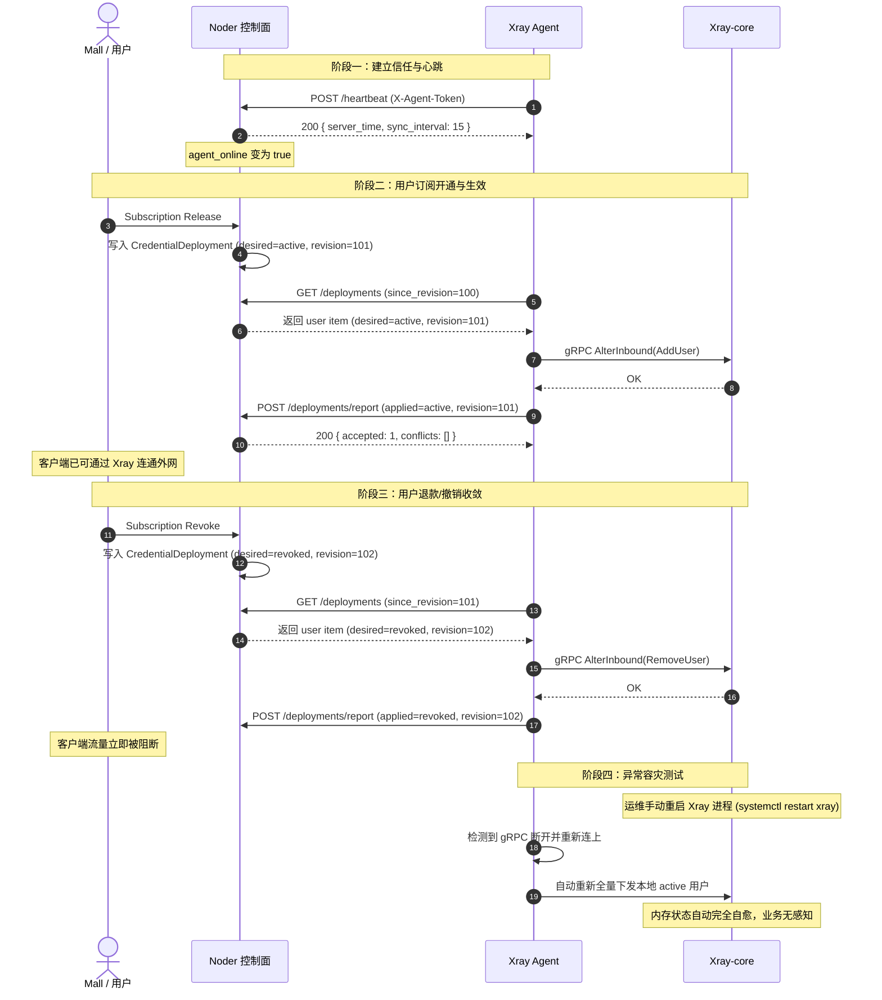

# Noder × Xray Agent 接口对接与研发对齐文档

> **文档目的**：供 Noder（控制面）与 Xray Agent（数据面）双方研发团队对齐 HTTP 契约、数据库字段、边界行为及联调计划。  
> **基础版本**：基于 `spec.md` (Draft v1.1) 与 Noder `main@39eef44` 模型设计。  
> **生效路由前缀**：`/api/agent/v1`

---

## 1. 核心对接原则与共识

1. **通信模式**：**Pull 模式为主**。线路机（Agent）主动向 Noder 轮询/上报；Noder 控制面不发起到 Agent 的入站连接。
2. **鉴权方式**：所有 `/api/agent/v1/*` 接口必须在 HTTP Header 携带 `X-Agent-Token: <token>`。Noder 负责校验 Token 并解析出绑定的 `agent_node_id`，越权访问其他 node/endpoint 返回 `403`。
3. **数据主键与单调版本**：
   - 部署主键：`(credential_id, endpoint_id, agent_node_id)`
   - 幂等用户键：`credential.email`（格式：`c_<cred>@<exit>`）
   - 版本控制：每个 deployment item 必须带有单调递增的 `revision`（如更新时间戳毫秒数 `1710000000123`），用于解决乱序与并发冲突。
4. **差异上报**：Agent 仅在状态改变（applied_state / error 变动）时调用上报接口，避免高频无脑全量 report 打满 Noder 数据库连接。

---

## 2. 接口契约定义（Noder 需提供）

### 通用响应结构
```json
// 成功
{
  "code": 0,
  "message": "success",
  "data": { ... }
}

// 失败
{
  "code": 400, // 或 401/403/500
  "message": "human readable error message",
  "error": "ERR_INVALID_TOKEN"
}
```

---

### 2.1 心跳：`POST /api/agent/v1/heartbeat`

Agent 定期（默认 15s）上报健康状态与自身能力；Noder 用于驱动 `AgentNode.status` 和 `grantReadiness.agent_online`。

#### 请求（Request）
- **Headers**: `X-Agent-Token: <token>`
- **Body**:
```json
{
  "agent_version": "1.0.0",
  "xray_version": "1.8.24",
  "hostname": "line-hk-01",
  "capabilities": ["xray.vless", "xray.vmess", "xray.trojan", "xray.shadowsocks", "traffic", "probe"],
  "endpoints": [
    {
      "endpoint_id": 123,
      "inbound_tag": "in-443",
      "ready": true
    }
  ]
}
```

| 字段 | 类型 | 必填 | 说明 |
|---|---|---|---|
| `agent_version` | string | 是 | Agent 程序版本 |
| `xray_version` | string | 是 | 本地受管 Xray-core 版本 |
| `hostname` | string | 否 | 主机名（观测排查用） |
| `capabilities` | string[] | 是 | 支持的协议与功能特性集合 |
| `endpoints` | object[] | 是 | 该 Agent 节点纳管的端点状态 |
| `endpoints[].endpoint_id` | int64 | 是 | Noder 端点 ID |
| `endpoints[].inbound_tag` | string | 是 | 对应的 Xray Inbound Tag |
| `endpoints[].ready` | bool | 是 | 本地 gRPC 与入站端口是否就绪 |

#### 响应（Response Data）
```json
{
  "server_time": "2026-11-09T14:00:00Z",
  "sync_interval_sec": 15
}
```

| 字段 | 类型 | 说明 |
|---|---|---|
| `server_time` | string (ISO8601) | Noder 服务器当前时间，供 Agent 校准时钟漂移 |
| `sync_interval_sec` | int | 建议 Agent 的下一次拉取周期（秒），支持动态调控 |

---

### 2.2 拉取期望部署：`GET /api/agent/v1/deployments`

Agent 拉取需在该节点生效的凭证部署快照或增量。

#### 请求参数（Query Parameters）
| 参数 | 类型 | 必填 | 说明 |
|---|---|---|---|
| `endpoint_id` | int64 | 否 | 缺省时返回该 Agent 绑定的所有端点项 |
| `since_revision` | string/int64 | 否 | 增量拉取时间戳/版本号。若提供，仅返回版本大于该值的条目（含 revoked 墓碑） |
| `limit` | int | 否 | 分页大小（默认 500，最大 2000） |
| `cursor` | string | 否 | 分页游标 |

#### 响应（Response Data）
```json
{
  "agent_id": "ag_01hx",
  "generated_at": "2026-11-09T14:00:00Z",
  "has_more": false,
  "next_cursor": null,
  "items": [
    {
      "deployment_key": {
        "credential_id": "cred_uuid_001",
        "endpoint_id": 123,
        "agent_node_id": "ag_01hx"
      },
      "desired_state": "active",
      "revision": "1710000000123",
      "grant": {
        "grant_id": "grant_uuid_001",
        "status": "active",
        "format": "landing",
        "expires_at": "2026-12-09T12:00:00Z",
        "traffic_quota_bytes": 107374182400,
        "traffic_used_bytes": 32212254720
      },
      "endpoint": {
        "endpoint_id": 123,
        "inbound_tag": "in-443",
        "server_address": "1.2.3.4",
        "server_port": 443,
        "protocol": "vless"
      },
      "credential": {
        "credential_id": "cred_uuid_001",
        "scheme": "vless",
        "email": "c_cred_uuid_001@line-hk-01",
        "uuid": "8b9e59d9-2e11-4712-a7d1-0f7236da4cfb",
        "username": null,
        "password": null,
        "flow": "xtls-rprx-vision",
        "cipher": null
      }
    }
  ]
}
```

#### 关键约束与字段说明：
1. **`desired_state`**：枚举值 `active` | `disabled` | `revoked`。
   - Noder 控制面在下发 `desired_state=active` 时，必须已完成授权可用性判定（未过期、未超额、未手动暂停）。
2. **`revision`**：字符串形式的单调递增计数（建议毫秒时间戳），每次 deployment 的任何期望字段变更必须升级该版本号。
3. **`inbound_tag`**：Noder 必须在 `endpoint` 节点中明确回传，Agent 据此直接确定调用 Xray gRPC `AlterInbound` 的入站目标。
4. **`credential` 协议字段规则**：
   - `scheme="vless"`：`uuid` 必填，`flow` 可选（如 `xtls-rprx-vision`）。
   - `scheme="vmess"`：`uuid` 必填。
   - `scheme="trojan"`：`password` 必填。
   - `scheme="shadowsocks"`：`password` 与 `cipher` 必填。

---

### 2.3 上报部署结果：`POST /api/agent/v1/deployments/report`

Agent 将本地 Xray 数据面的收敛结果批量回传 Noder。

#### 请求（Request）
- **Headers**: `X-Agent-Token: <token>`
- **Body**:
```json
{
  "items": [
    {
      "credential_id": "cred_uuid_001",
      "endpoint_id": 123,
      "applied_state": "active",
      "revision": "1710000000123",
      "applied_at": "2026-11-09T14:00:05Z",
      "error": null,
      "xray_user_key": "c_cred_uuid_001@line-hk-01"
    }
  ]
}
```

| 字段 | 类型 | 必填 | 说明 |
|---|---|---|---|
| `credential_id` | string | 是 | 凭据 UUID |
| `endpoint_id` | int64 | 是 | 端点 ID |
| `applied_state` | string | 是 | `active` \| `revoked` \| `disabled` \| `failed` |
| `revision` | string | 是 | 本次成功应用的期望版本号 |
| `applied_at` | string (ISO8601) | 是 | 数据面生效时间戳 |
| `error` | string | 否 | 若 `applied_state=failed`，必填脱敏后的错误简述 |
| `xray_user_key` | string | 是 | Xray 中的用户 email 标识 |

#### 响应（Response Data）
```json
{
  "accepted": 1,
  "conflicts": [
    {
      "credential_id": "cred_uuid_old",
      "endpoint_id": 123,
      "reason": "stale_revision",
      "current_revision": "1710000000200"
    }
  ]
}
```

#### 冲突处理机制：
- **`stale_revision`**：Noder 接收到 report 时，若发现 `report.revision < DB.current_revision`，则**不更新**该条目的 `applied_state`，并将其加入 `conflicts` 列表回传。
- Agent 收到该冲突后，丢弃本地冲突项的旧缓存，并在下个周期重新获取最新 revision。

---

### 2.4 （P1）流量上报：`POST /api/agent/v1/traffic/report`

Agent 定期（如 60s）读取 Xray `StatsService` 并上报流量。

#### 请求（Request）
```json
{
  "report_id": "b1b0f580-c081-42cb-b70d-327c1514781a",
  "endpoint_id": 123,
  "observed_at": "2026-11-09T14:01:00Z",
  "items": [
    {
      "credential_id": "cred_uuid_001",
      "grant_id": "grant_uuid_001",
      "uplink_bytes": 1048576,
      "downlink_bytes": 5242880
    }
  ]
}
```

#### 响应（Response Data）
```json
{
  "accepted": true
}
```

#### 计费幂等要求：
- 请求携带全局唯一 `report_id`（UUID v4）。
- Agent 若遇到 HTTP 5xx 或网络超时发生重试，**必须保留完全相同的 `report_id`**。
- Noder 端使用 Redis / DB 对 `report_id` 进行去重（TTL 24h）。若已处理过该 `report_id`，直接返回 `{ "accepted": true }`，**坚决杜绝重复加算**。

---

## 3. Noder 侧改动清单（已实现，全套单元测试通过）

| 模块 / 文件 | 改动内容 | 状态与验证说明 |
|---|---|---|
| `internal/handler/agent_auth.go` | 新增 `AgentAuth` 中间件，校验 `X-Agent-Token`，通过 `agent_nodes` 表鉴权并注入 `AgentNode` 上下文；提供 `requireAgentEndpointAccess` 防越权校验 | **已实现**（测试用例：401 未授权、403 越权端点覆盖） |
| `internal/handler/agent_sync.go` | 实现 `AgentHeartbeat`、`AgentGetDeployments`、`AgentReportDeployments`、`AgentReportTraffic` 核心逻辑 | **已实现**（路由前缀 `/api/agent/v1`） |
| `cmd/server/main.go` | 注册 Agent 路由族 `handler.RegisterAgentRoutes(r)`，挂载至全局 Chi Router | **已实现**（上线必须走 HTTPS） |
| `internal/db/db.go` & `domain.go` | 1. 扩容 `credential_deployments.revision` 字段及联合索引 `(agent_node_id, endpoint_id, revision)`；<br>2. 新增 `agent_traffic_reports` 去重表用于 24h 幂等；<br>3. `RevokeCredential`、`createDesiredDeployments` 写入单调递增毫秒级 revision | **已实现** |
| `internal/handler/service_subscription.go` | 移除硬编码 `grantReadiness.agent_online=false`，改为基于 `isAgentOnlineForEndpoint` 动态计算（`last_heartbeat_at > now - 90s`） | **已实现**（对齐 Mall 交付门禁与心跳状态感知） |
| `internal/handler/agent_sync_test.go` | 新增覆盖心跳、期望拉取、增量拉取、版本冲突回退、流量幂等上报的独立单元测试套件 | **已通过**（`go test -v -run "TestAgent" ./internal/handler` 全部 PASS） |

---

## 4. Xray Agent 侧核心机制保证（数据面保证）

1. **Xray 重启全量自愈**：
   - Agent 监控 Xray gRPC 连接与进程健康。
   - 一旦检测到 Xray 重启，Agent 立即从本地持久化缓存把所有 `active` 用户批量重新灌入 Xray，无需等待 Noder 控制面介入。
2. **配置更新（Update）规范**：
   - Xray gRPC 无原生 update 原语。Agent 遇配置变动必须执行原子操作：`RemoveUser(email)` -> `AddUser(new)`。
3. **全量 Reconcile 防误删**：
   - 启动拉取 deployments 时，若存在分页，Agent 必须拉完完整分页后再做差异对比，禁止单页处理。
   - 若同步异常失败，保持现有 Xray 状态，绝不触发清空。

---

## 5. 联合调试与验收计划

双方联调遵循以下用例逐步闭环：



---
**对齐确认签署**：
- Xray Agent 端：`已完成核心引擎、客户端与 Store 实现（单测 PASS）`
- Noder 控制面端：`已完成全部契约接口实现与单元测试验证（单测 PASS）`
- 联调状态：`双端契约完全对齐，随时可启动实机端到端联调`
