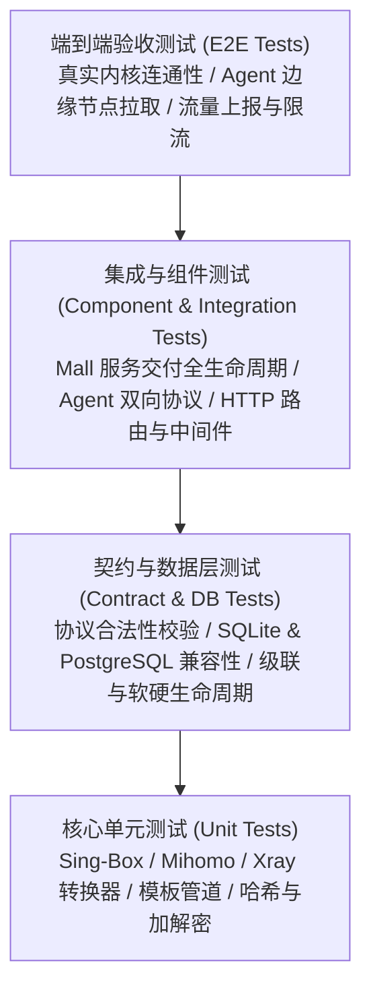

# Noder 全景测试策略与质量保证规范

本文档定义 **Noder (Sing-Box / Mihomo / Xray 订阅中间件与代理控制面服务)** 的全景测试工程策略、质量保证体系、分层测试模型、测试环境建设规范及质量门禁准则。

---

## 1. 质量愿景与工程目标

Noder 作为承载网络代理基础设施控制面、动态凭证下发、多内核订阅动态拼接以及与商业系统 (Mall) 自动化对接的核心中间件，其质量工程的核心目标是：

1. **高安全性 (Security & Credential Isolation)**：
   - 彻底贯彻「基建节点不存用户私钥/密码」设计（方案 3 独立凭证与动态拼接）。
   - 严密防护管理员权限、服务间权限（`X-Service-Token`）与节点控制面权限（`Agent Token`），敏感信息日志脱敏。
2. **高保真一致性 (Multi-Core Subscription Fidelity)**：
   - 保证 Sing-Box、Mihomo (Clash Meta)、Xray 等不同客户端内核配置渲染的严格语法遵从性与协议标准性。
3. **高可靠事务一致性 (Idempotent Lifecycle Management)**：
   - 保证 Mall 商业开通、放行、续费、充值、撤销全链路具备严格幂等性，杜绝重复扣费、漏下发、状态脱节等事故。
4. **控制面最终一致性 (Agent Control Plane Self-Healing)**：
   - 保障跨地域、跨公网边缘 Agent 节点的凭证下发与撤销具备幂等重试、状态确认与断网自愈能力。

---

## 2. 测试金字塔与分层测试体系

本系统采用经典且落地的分层测试模型，明确各层职责边界：



### 2.1 单元测试层 (Unit Tests)
- **范围**：各独立函数、转换器、工具包及无副作用业务逻辑。
- **重点覆盖**：
  - `internal/service/singbox`：Sing-Box 出站 JSON 生成、TCP 传输过滤、URLTest/Selector 注入。
  - `internal/service/mihomo`：Mihomo 出站 YAML 生成、Proxy-Group 合并、xhttp 传输层非法校验。
  - `internal/service/xray`：Xray 出站追加、非 VLESS 协议自动过滤、传输协议映射。
  - `internal/service/file`：SHA-256 哈希计算、文件路径映射、文件扩展名推断、远程 URL 校验。
  - `internal/service/template`：模板变量替换、占位符渲染引擎。
  - `internal/jsonutil`：JSON 结构深合并与字段替换。
- **目标指标**：语句覆盖率（Statement Coverage）> 85%，执行速度 < 1s。

### 2.2 契约与数据持久层测试 (Contract & DB Tests)
- **范围**：协议参数定义模型、数据库模型约束、迁移脚本兼容性。
- **重点覆盖**：
  - `internal/contract`：VLESS Reality 四元组（`public_key`, `short_id`, `sni`, `fingerprint`）必填校验；TUIC 协议固定参数校验；XHTTP 传输层限制校验。
  - `internal/db`：领域模型生命周期判定（`GetActiveDomainEndpoints` 对 `active`/`revoked`/`expired` 的严格判定）；数据表级联清理；SQLite (modernc) 与 PostgreSQL 驱动行为对齐。
- **目标指标**：语句覆盖率 > 75%。

### 2.3 集成与服务测试 (Integration & Handler Tests)
- **范围**：HTTP API 鉴权拦截、请求参数反序列化、业务领域编排及状态机流转。
- **重点覆盖**：
  - `internal/handler/service_*`：Mall 对接核心流程（`activate` -> `release` -> `extend` -> `quota` -> `revoke`），包含零绑定阻断（`40902 BINDING_MISSING`）与幂等重放。
  - `internal/handler/agent_*`：Agent 心跳维持、凭证期望状态拉取（Desired State）、实际状态确认与错误上报。
  - `internal/handler/subscription.go`：多端订阅接口（`/sub`, `/mihomo`, `/xray`, `/node`）鉴权、状态过滤与端点级排序。
  - `internal/handler/download.go`：ZIP 模板动态重写与引导页面渲染。
- **目标指标**：核心业务接口 100% 具备自动化用例，语句覆盖率 > 70%。

### 2.4 端到端验收测试 (E2E Tests)
- **范围**：跨进程与跨网络真实交互。
- **参考规范**：`doc/e2e/xray-agent-integration.md` 与 `doc/e2e/README.md`。
- **重点场景**：
  - Noder Server 与真实 Xray Agent 启动联调；
  - 动态下发凭证后，真实代理客户端成功发起 TLS / Reality 握手并代理请求；
  - 凭证撤销后，连接在 1 秒内被物理切断且无法重连。

---

## 3. 核心业务域与测试矩阵

| 业务域 | 核心职责 | 测试关注重点 | 关键用例集 |
| :--- | :--- | :--- | :--- |
| **1. 节点与协议契约** | 基础设施节点定义与协议参数校验 | VLESS Reality 完整性、TUIC 拥塞算法、XHTTP 特殊约束、敏感信息不入库 | TC-NODE-001 ~ 006 |
| **2. 用户与授权生命周期** | 用户管理、凭证分发、端点绑定 | UUID/密码默认回退、自定义端点凭证、用户停用全局阻断、级联解绑 | TC-USER-001 ~ 007 |
| **3. 多核心动态订阅** | Sing-Box / Mihomo / Xray 配置渲染 | TCP 传输清洗、代理组策略路由、Xray TUIC 自动跳过、未启用节点过滤 | TC-SUB-001 ~ 007 |
| **4. 文件分发与模板注入** | 客户端分发、动态 ZIP 重写、模板版本 | SHA-256 去重、远程缓存 TTL、ZIP 注入凭证、模板多版本与回滚 | TC-FILE-001 ~ 007 |
| **5. Mall 自动化交付** | 商业订单开通、放行、续费、充值与撤销 | 两阶段交付 (`activate` -> `release`)、零绑定防御、单据幂等、状态机闭环 | TC-MALL-001 ~ 009 |
| **6. Agent 控制面调度** | 边缘节点注册、心跳、凭证同步与部署 | 期望状态下发、断网重连自愈、并发冲突防御、故障上报 | TC-AGENT-001 ~ 005 |
| **7. 系统鉴权与安全防护** | 权限隔离、脱敏防泄漏、异常保护 | Admin Token / Service Token / Agent Token 三权分立、日志脱敏、防重放 | TC-SEC-001 ~ 005 |

---

## 4. 测试环境与测试数据治理

### 4.1 测试环境分类

1. **本地单元测试环境 (Local In-Memory / Temp SQLite)**：
   - 依赖 Go 原生 `testing` 框架及 `os.MkdirTemp`。
   - 每次测试生成独立临时 SQLite 数据库并运行初始迁移，测试结束自动清理目录与文件，杜绝用例间数据污染。
2. **容器化集成测试环境 (Docker Compose PostgreSQL)**：
   - 使用与生产一致的 PostgreSQL 16 镜像运行迁移与契约测试。
   - 针对两类数据库驱动做双重兼容性验证（尤其是 `ON CONFLICT`、字段类型转换与事务隔离级别）。
3. **E2E 仿真沙箱 (Simulation Sandbox)**：
   - 使用 Mock HTTP 服务仿真外部 Mall 回调与远程二进制下载。
   - 运行 Xray/Sing-Box 临时守护进程接收测试流量验证连通性。

### 4.2 测试数据治则
- **数据独立性**：每个 Test Suite 拥有独立的上下文，禁止共享全局可变状态。
- **时间确定性**：涉及过期（`expires_at`）、缓存（`cached_at`）、心跳（`last_heartbeat_at`）测试时，使用相对于 `time.Now()` 的明确偏移行程（如 `+30d`, `-1h`）。
- **敏感数据测试安全**：测试用例中严禁出现真实生产服务器 IP、生产域名与真实私钥，统一采用 RFC 5737 规定的测试 IP 段（如 `198.51.100.0/24`、`203.0.113.0/24`）与示例域名（`example.com`）。

---

## 5. 自动化测试执行指南

### 5.1 本地测试执行

```bash
# 1. 执行全量 Go 单元测试与集成测试
go test ./...

# 2. 统计并输出各模块代码覆盖率
go test -cover ./...

# 3. 运行特定模块并显示详细日志 (以 service/mihomo 为例)
go test -v -cover ./internal/service/mihomo/...

# 4. 执行特定用例 (如 Mall 两阶段交付测试)
go test -v ./internal/handler/... -run "TestServiceSubscriptionLifecycle|TestSpec_7_1_1_Release_ZeroBinding"

# 5. 生成可视化覆盖率 HTML 报告
go test -coverprofile=coverage.out ./...
go tool cover -html=coverage.out -o coverage.html
```

### 5.2 前端代码静态与编译检查

```bash
cd web
# 前端类型检查与生产打包验证
pnpm install
pnpm run build
```

---

## 6. 质量门禁与准出标准 (Definition of Done)

任何功能交付或重构必须满足以下准出标准方可合并至主分支：

| 检查维度 | 准出指标 | 验证方式 |
| :--- | :--- | :--- |
| **代码编译** | 后端二进制及前端静态资源 0 Warning / 0 Error 编译成功 | `make build` 或 `go build` + `pnpm build` |
| **单元测试** | 全量单元测试用例 100% PASS，无死锁、无竞态 | `go test -race ./...` |
| **核心代码覆盖率** | 核心转换服务（`service/*`）> 80%，数据层（`db/*`）> 70% | `go test -cover` |
| **原子化提交** | 每次提交单一职责，严格遵循 Conventional Commits | `git log` 审查 |
| **零缺陷政策** | P0（阻断级）、P1（严重级）缺陷为 0 | 缺陷管理跟踪与回归测试 |
| **安全审查** | 节点表无私钥字段残留、API 敏感凭证日志脱敏、鉴权中间件覆盖 | 静态扫描与鉴权测试套件 |
